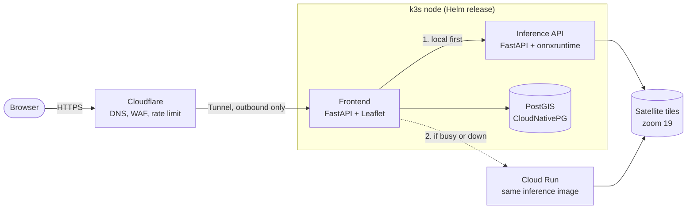

# Cocolit 🌴

**Count coconut trees from satellite imagery.** Draw a box on the map, and a
[YOLO11n](https://docs.ultralytics.com/models/yolo11/) detection model
(Ultralytics, AGPL-3.0) marks every coconut tree inside it.

**Live:** [cocolit.prithvilabs.com](https://cocolit.prithvilabs.com)


I built Cocolit to learn how to design a machine learning system end to end:
model serving, a web app, a spatial database, deployment and cost control. It
is a working product, kept small enough to run for free.

## Features

- **Draw to detect:** press **Draw a box** and drag (mouse or finger) over up
  to 0.5 km²; a live tooltip shows the area while you draw.
- **Try another location:** jump between dense coconut areas in Sri Lanka,
  India and Mexico, each checked by running the model on the spot.
- **Every tree marked:** each detected coconut tree is drawn on the map, with the
  count, area and trees per km² for your session.
- **Statistics:** every scan is saved in PostGIS and summarised as
  a heatmap and a per-country table.
- **Fast, CPU-only inference:** 2.5 km² (≈480 map tiles) in about 3 s on one
  machine, with no GPU.
- **Overflow to Cloud Run:** when the main inference service is busy or down,
  requests go to a scale-to-zero Cloud Run service instead of queueing.

## How it works



1. The browser sends the drawn box to the **frontend**, a FastAPI app that
   also serves the static map UI (vanilla JS and Leaflet). Cloudflare sits in
   front: DNS, TLS, a rate limit on `/api/inference`, and a Tunnel, so the
   node has no open inbound ports.
2. The frontend validates the size and calls the **inference API**. If that
   service is already busy (or down), it calls the **Cloud Run** copy instead.
3. The inference API fetches the zoom-19 satellite tiles for the box
   concurrently and stitches them into an in-memory image, then cuts it into
   640 × 640 patches.
4. Each row of patches goes to the **YOLO11n** model (ONNX, run with
   onnxruntime) **as soon as its tiles arrive**, so downloading and inference
   overlap.
5. Box centres are converted to map coordinates (EPSG:3857) and returned as
   GeoJSON. The frontend stores the box and the trees in **PostGIS** and draws
   them on the map.

### Performance

Measured on an Apple M1 with `scripts/benchmark_inference.py` (detections are
identical before and after):

| Area | Earlier pipeline | Now | Peak memory |
|---|---|---|---|
| 0.1 km² | 0.38 s | 0.21 s | 263 MB |
| 1 km² | 1.70 s | 1.40 s | 365 MB |
| 2.5 km² | 4.52 s | 3.08 s | 525 MB |
| 4.9 km² | 8.04 s | 5.9 s | 723 MB |

What made the difference:

- tiles fetched and decoded in parallel straight into memory, instead of
  writing GeoTIFFs to disk and reading them back;
- the model starting on the first rows while later tiles are still
  downloading;
- the model run directly with onnxruntime (identical boxes and scores to
  Ultralytics), which removed PyTorch from the inference image. The image
  is now 111 MB compressed and idles at about 160 MB of RAM.

## Tech stack

| Part | Technology |
|---|---|
| Model | YOLO11n by Ultralytics (AGPL-3.0), trained for one class (coconut tree), served as ONNX on onnxruntime; see [models/README.md](models/README.md) |
| Inference API | FastAPI, httpx, NumPy, Pillow |
| Frontend | FastAPI, vanilla JS, Leaflet, Turf.js |
| Database | PostgreSQL + PostGIS on CloudNativePG, SQLModel / GeoAlchemy2 |
| Platform | k3s, Helm, Cloudflare Tunnel, Google Cloud Run (overflow) |
| Infrastructure as code | OpenTofu (Oracle Cloud Always Free node) |

## Project layout

```
main.py                  Frontend API (/api/inference, /api/statistics) + static UI
static/                  Map UI: index.html, style.css, js/app.js
src/api/inference.py     Inference API (/predict, /health)
pipelines/inference.py   Download → detect → GeoJSON pipeline, with timings
src/utils/tiles.py       Concurrent tile download and streaming 640 px patches
src/utils/detector.py    YOLO pre/post-processing (NMS) on onnxruntime
src/inference_router.py  Local-first routing with Cloud Run overflow
src/database/, src/dal/  Tables and database access (PostGIS)
models/best.onnx         Trained YOLO11n model (AGPL-3.0, see models/README.md)
infra/charts/cocolit/    Helm chart (app, PostGIS, cloudflared)
infra/oci/               OpenTofu for an Oracle Cloud A1 k3s node
scripts/                 Benchmark and deploy scripts
tests/                   Unit tests (tests/integration needs network)
```

## Run it locally

You need Python 3.11+.

```bash
git clone https://github.com/davnish/cocolit && cd cocolit
python -m venv .venv && source .venv/bin/activate
pip install -r requirements_inference.txt -r requirements_streamlit.txt

# Terminal 1: inference API
uvicorn src.api.inference:app --port 8000

# Terminal 2: frontend (open http://localhost:8501)
INFERENCE_URL=http://127.0.0.1:8000/predict uvicorn main:app --port 8501
```

Without database settings the app still detects trees; it just doesn't save
scans or show statistics. To use a PostGIS database, set
`POSTGRES_HOST`, `POSTGRES_DATABASE`, `POSTGRES_USERNAME` and
`POSTGRES_PASSWORD` (or `local_database` to a full connection URL). Tables are
created on startup.

### Tests and benchmark

```bash
pytest tests --ignore=tests/integration
python -m scripts.benchmark_inference --sizes 0.1 0.5 1 2.5
```

## Deployment

The app runs as a Helm release on a single k3s node, exposed only through a
Cloudflare Tunnel (no open inbound ports), with Cloudflare rate limiting on
`/api/inference`.

- **Single node on k3s:** `scripts/deploy_laptop.sh` builds both images and
  installs the chart with `infra/charts/cocolit/values-laptop.yaml` (k3s on
  Colima). The same chart targets an Oracle Cloud Always Free Ampere A1 node,
  defined in `infra/oci/`.
- **Cloud Run overflow:** `PROJECT=<gcp-project> scripts/deploy_cloud_run.sh`
  builds the inference image with Cloud Build and deploys it with
  min-instances 0, max-instances 2 and an API key, then stores the URL and key
  in the cluster. Enable it with `--set overflow.enabled=true`.
- **Secrets** (database, tunnel token, Cloud Run key) live in Kubernetes
  secrets or a gitignored values file, never in the repository.

## Limitations and next steps

- Boxes are limited to 0.5 km² in the UI (5 km² in the API) to keep requests
  fast on a small CPU node.
- No download of predictions yet (GeoJSON / shapefile export is planned).
- An INT8 version of the model is about 1.8× faster but agrees with FP32 on
  only 90–96% of trees; it needs validating on labelled data before use.
- Planned: tracing and metrics in Grafana Cloud (OpenTelemetry is
  instrumented but not yet wired up), multi-arch images in CI, and a cache for
  repeated areas.

## License

- **Code:** [MIT](LICENSE).
- **Model weights** (`models/best.onnx`): **AGPL-3.0**. The detector is
  [YOLO11n](https://docs.ultralytics.com/models/yolo11/) by Ultralytics, whose
  code and pretrained weights are AGPL-3.0, and this model was trained from
  them. See [models/README.md](models/README.md) and [models/LICENSE](models/LICENSE).
- Satellite imagery is © Google and is not part of this repository.
