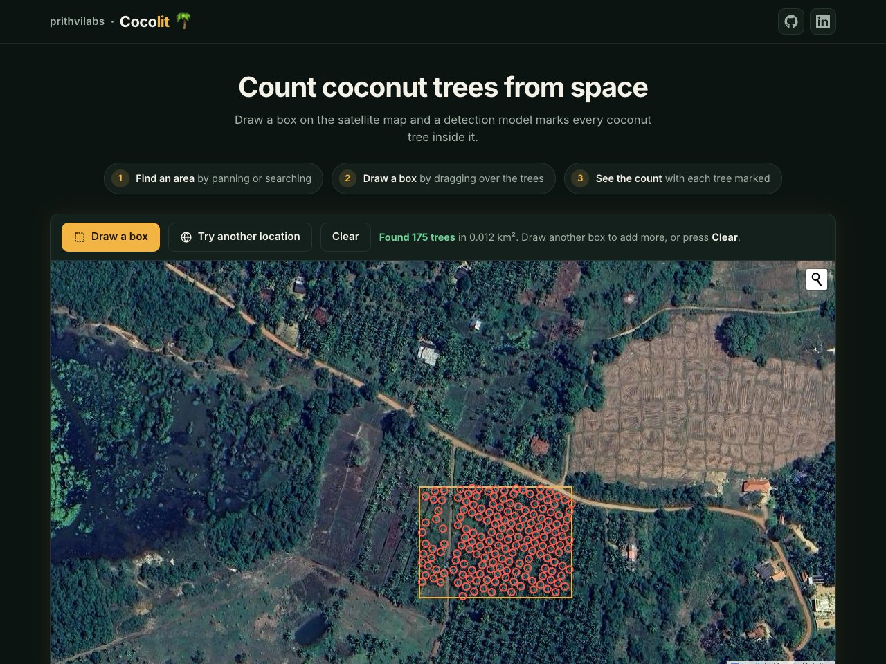

<div align="center">

# 🌴 Cocolit

**Count coconut trees from space.**

Draw a box on a satellite map and Cocolit finds every coconut tree inside it,
in a few seconds, on a plain CPU.

### [👉 Try it live at cocolit.prithvilabs.com](https://cocolit.prithvilabs.com)



</div>

## ✨ Try it in 30 seconds

1. **Open** [cocolit.prithvilabs.com](https://cocolit.prithvilabs.com). The map
   starts on a coconut plantation in Sri Lanka.
2. **Press _Draw a box_** and drag over the trees. It works with a mouse or a
   finger.
3. **Watch the count.** Every tree gets a red circle, and you see the total
   and the trees per km².

Want somewhere else? Press **🌐 Try another location** to jump to coconut
farms in India and Mexico, or search for any place on Earth.

## 🥥 What you can do

| | |
|---|---|
| 🟧 **Draw to detect** | Drag a box up to 0.5 km²; a tooltip shows the area as you draw |
| 🌐 **Try another location** | Hop between dense coconut areas, each checked with the model |
| 🔴 **See every tree** | Each detected tree is circled, with the count and density |
| 📍 **Coordinates bar** | See where you're pointing; click to pin a spot and copy it |
| 📊 **Statistics** | A heatmap and per-country table of every scan anyone has made |
| 📱 **Phone friendly** | The whole thing works with touch |

## 🛠️ How it works


In plain words:

1. **You draw a box.** The website checks the size and sends it to the
   detector.
2. **The detector fetches satellite imagery** for that box, many tiles at once,
   straight into memory.
3. **A YOLO11n model looks for coconut trees** in 640 × 640 pixel pieces. It
   starts on the first pieces while the rest are still downloading, which saves
   time.
4. **The trees come back as points on the map**, and the result is saved for
   the statistics.
5. **If the detector is busy**, the request goes to a backup copy on Google
   Cloud Run instead of waiting.

Want the full picture? See **[docs/architecture.md](docs/architecture.md)**.

### ⚡ How fast is it?

On a laptop CPU (Apple M1), no GPU:

| Area you draw | Time | Memory |
|---|---|---|
| 0.1 km² (a small farm) | 0.2 s | 263 MB |
| 1 km² | 1.4 s | 365 MB |
| 2.5 km² | 3.1 s | 525 MB |

That's about 1.5× faster and 30% lighter than the first version, with exactly
the same detections. The detector's container image is just 111 MB.

## 🚀 Run it on your machine

You need **Python 3.11+**.

```bash
git clone https://github.com/davnish/cocolit && cd cocolit
python -m venv .venv && source .venv/bin/activate
pip install -r requirements_inference.txt -r requirements_streamlit.txt
```

Then start the two parts, each in its own terminal:

```bash
# 1. The detector
uvicorn src.api.inference:app --port 8000

# 2. The website
INFERENCE_URL=http://127.0.0.1:8000/predict uvicorn main:app --port 8501
```

Open **<http://localhost:8501>** and draw a box. 🎉

> 💡 No database needed to try it. Without one, detection works; results
> just aren't saved and statistics stay empty. To save them, copy
> [`.env.example`](.env.example) to `.env` and fill in the `POSTGRES_*` settings.

**Run the tests:**

```bash
pytest tests --ignore=tests/integration
```

## 🗂️ What's where

```
main.py                  the website's API (+ serves the map page)
static/                  the map page: index.html, style.css, js/app.js
src/api/inference.py     the detector's API
pipelines/inference.py   fetch imagery → detect trees → points
src/utils/tiles.py       downloads satellite tiles, cuts 640 px pieces
src/utils/detector.py    runs the YOLO11n model
src/inference_router.py  sends requests to the backup when busy
src/database/, src/dal/  saving and reading results (PostGIS)
models/best.onnx         the trained model (see models/README.md)
infra/                   Helm chart, Oracle Cloud and AWS setup
scripts/                 deploy and benchmark scripts
tests/                   tests
```

## ☁️ Where it runs

Cocolit is built to run **for free**:

- **One small Kubernetes (k3s) server** runs the website, the detector and the
  database. Today that's a laptop; next it's an Oracle Cloud Always Free
  server ([`infra/oci/`](infra/oci/)).
- **Cloudflare** sits in front: the domain, HTTPS, rate limiting, and a
  tunnel, so the server never opens a port to the internet.
- **Google Cloud Run** holds a backup detector that costs nothing when idle.

Deploy scripts: [`scripts/deploy_laptop.sh`](scripts/deploy_laptop.sh) and
[`scripts/deploy_cloud_run.sh`](scripts/deploy_cloud_run.sh). The details are
in the [architecture doc](docs/architecture.md#deployment).

## 🧭 What's next

- ⬇️ Download your results as GeoJSON or a shapefile
- 📈 Live dashboards and tracing in Grafana Cloud
- ⚡ A faster INT8 model, once it's checked against labelled data
- 🗺️ Remembering areas that were already scanned

Ideas or bugs? [Open an issue](https://github.com/davnish/cocolit/issues). 🙌

## 🧱 Built with

[YOLO11n](https://docs.ultralytics.com/models/yolo11/) ·
[onnxruntime](https://onnxruntime.ai/) · [FastAPI](https://fastapi.tiangolo.com/) ·
[Leaflet](https://leafletjs.com/) · [PostGIS](https://postgis.net/) ·
[k3s](https://k3s.io/) · [Cloudflare](https://www.cloudflare.com/) ·
[Cloud Run](https://cloud.google.com/run)

## 📄 License

- **Code:** [MIT](LICENSE). Use it freely.
- **The model** (`models/best.onnx`) is **AGPL-3.0**. It's
  [YOLO11n](https://docs.ultralytics.com/models/yolo11/) by Ultralytics, trained
  to find coconut trees. See [models/README.md](models/README.md).
- Satellite imagery © Google.

<div align="center">

Made by [Nischal Singh](https://www.linkedin.com/in/nischal-singh/) at
**prithvilabs** 🌍

</div>
