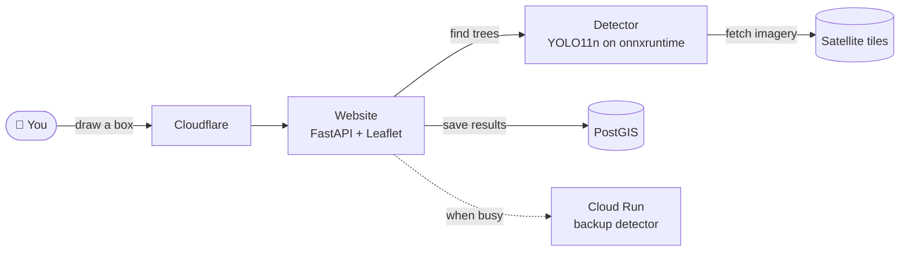

<div align="center">

# 🌴 Cocolit

**Count coconut trees from space.**

Draw a box on a satellite map and Cocolit finds every coconut tree inside it,
in a few seconds, on a plain CPU.

[](https://github.com/davnish/cocolit/actions/workflows/ci_cd.yml)
[](https://github.com/davnish/cocolit/releases)
[](https://davnish.github.io/cocolit/)
[](LICENSE)
[](models/README.md)

**[Live demo](https://cocolit.prithvilabs.com)** ·
**[Documentation](https://davnish.github.io/cocolit/)** ·
**[Architecture](https://davnish.github.io/cocolit/architecture/)** ·
**[Releases](https://github.com/davnish/cocolit/releases)**

</div>

## 👋 About

Cocolit began as a hobby project to explore what it takes to build a
geospatial ML app end to end. Along the way it became a place to try things
out: saving predictions to a database, running services on Kubernetes,
networking, and managing cloud infrastructure as code with **OpenTofu**.

### The setup today

A **YOLO11n** model, trained to spot coconut trees, runs on **onnxruntime**
behind a **FastAPI** service. A second FastAPI service serves the **Leaflet**
map and saves every scan to **PostGIS**.

All three (the website, the detector and the database) run on a single
**k3s** Kubernetes node in **Oracle Cloud**. Visitors reach it through a **Cloudflare Tunnel**, so
the node never opens a port to the internet, and the database stays private
inside the cluster. When the detector is busy, requests spill over to a backup
copy on **Google Cloud Run** that costs nothing when idle.

## Contents

- [Try it in 30 seconds](#-try-it-in-30-seconds)
- [Features](#-features)
- [How it works](#️-how-it-works)
- [Run it on your machine](#-run-it-on-your-machine)
- [Project layout](#️-project-layout)
- [Where it runs](#️-where-it-runs)
- [How the project evolved](#-how-the-project-evolved)
- [What's next](#-whats-next)
- [License](#-license)
- [Screenshot](#-screenshot)

## ✨ Try it in 30 seconds

1. **Open** [cocolit.prithvilabs.com](https://cocolit.prithvilabs.com). The map
   starts on a coconut plantation in Sri Lanka.
2. **Press _Draw a box_** and drag over the trees. It works with a mouse or a
   finger.
3. **Read the count.** Every tree gets a red circle, and you see the total
   and the trees per km².

Want somewhere else? Press **Try another location** to jump to coconut farms
in India and Mexico, or pan to any place on Earth.

## 🥥 Features

| | |
|---|---|
| 🟧 **Draw to detect** | Drag a box up to 0.5 km²; a tooltip shows the area as you draw |
| 🌐 **Try another location** | Hop between dense coconut areas, each checked with the model |
| 🔴 **See every tree** | Each detected tree is circled, with the count and density |
| 📍 **Coordinates bar** | See where you're pointing; click to pin a spot and copy it |
| 📊 **Statistics** | A heatmap and per-country table of every scan anyone has made |
| 📱 **Phone friendly** | Everything works with touch |

## 🛠️ How it works



1. **You draw a box.** The website checks the size and sends it to the
   detector.
2. **The detector fetches satellite imagery** for that box, many tiles at once,
   straight into memory.
3. **A YOLO11n model looks for coconut trees** in 640 × 640 pixel pieces. It
   starts on the first pieces while the rest are still downloading.
4. **The trees come back as points on the map**, and the result is saved for
   the statistics.
5. **If the detector is busy**, the request goes to a backup copy on Google
   Cloud Run instead of waiting.

### Go deeper

The documentation site covers each part in detail:

| Topic | Read |
|---|---|
| The whole system in one diagram | [System overview](https://davnish.github.io/cocolit/architecture/#system-overview) |
| The map page and request routing | [Frontend](https://davnish.github.io/cocolit/architecture/#frontend) |
| Tile download, the model, timings | [Inference API](https://davnish.github.io/cocolit/architecture/#inference-api) |
| Tables and what gets saved | [Database](https://davnish.github.io/cocolit/architecture/#database) |
| Kubernetes, Cloudflare, Cloud Run, Oracle Cloud | [Deployment](https://davnish.github.io/cocolit/architecture/#deployment) |
| Every environment variable | [Configuration](https://davnish.github.io/cocolit/architecture/#configuration) |

### ⚡ Performance

On a laptop CPU (Apple M1), no GPU:

| Area you draw | Time | Memory |
|---|---|---|
| 0.1 km² (a small farm) | 0.2 s | 263 MB |
| 1 km² | 1.4 s | 365 MB |
| 2.5 km² | 3.1 s | 525 MB |

That's about 1.5× faster and 30% lighter than the version before it, with exactly the same
detections. The detector's container image is 111 MB.

## 🚀 Run it on your machine

You need **Python 3.11+**.

```bash
git clone https://github.com/davnish/cocolit && cd cocolit
python -m venv .venv && source .venv/bin/activate
pip install -r requirements_inference.txt -r requirements_streamlit.txt
```

Then start the two parts, each in its own terminal:

```bash
# 1. The detector
uvicorn src.api.inference:app --port 8000

# 2. The website
INFERENCE_URL=http://127.0.0.1:8000/predict uvicorn main:app --port 8501
```

Open **<http://localhost:8501>** and draw a box.

> 💡 You don't need a database to try it. Without one, detection works; results
> just aren't saved and statistics stay empty. To save them, copy
> [`.env.example`](.env.example) to `.env` and fill in the `POSTGRES_*` settings.

**Run the tests:**

```bash
pytest tests --ignore=tests/integration
```

## 🗂️ Project layout

```
main.py                  the website's API (+ serves the map page)
static/                  the map page: index.html, style.css, js/app.js
src/api/inference.py     the detector's API
pipelines/inference.py   fetch imagery → detect trees → points
src/utils/tiles.py       downloads satellite tiles, cuts 640 px pieces
src/utils/detector.py    runs the YOLO11n model
src/inference_router.py  sends requests to the backup when busy
src/database/, src/dal/  saving and reading results (PostGIS)
models/best.onnx         the trained model (see models/README.md)
infra/                   Helm chart, Oracle Cloud and AWS setup
scripts/                 deploy and benchmark scripts
docs/                    the documentation site (mkdocs)
tests/                   tests
```

## ☁️ Where it runs

Cocolit is built to run **for free**:

- **One small Kubernetes (k3s) server on Oracle Cloud** runs the website, the
  detector and the database. Today it's an x86 VM in Hyderabad; it moves to an
  Always Free Arm (A1) server as soon as Oracle has capacity. Both are defined
  with OpenTofu in [`infra/oci/`](infra/oci/).
- **Cloudflare** sits in front: the domain, HTTPS, rate limiting, and a
  tunnel, so the server never opens a port to the internet.
- **Google Cloud Run** holds a backup detector that costs nothing when idle.

Deploy scripts: [`scripts/deploy_oci.sh`](scripts/deploy_oci.sh) (Oracle
Cloud), [`scripts/deploy_cloud_run.sh`](scripts/deploy_cloud_run.sh) (backup
detector) and [`scripts/deploy_laptop.sh`](scripts/deploy_laptop.sh) (a local
k3s for testing). The details are
in the [deployment guide](https://davnish.github.io/cocolit/architecture/#deployment).

## 📜 How the project evolved

Cocolit was rebuilt a few times as it grew. Each stage solved the biggest problem of the one before.

| When | Stage | What changed |
|---|---|---|
| **Apr 2025** | 🌱 The experiment | A YOLO model trained on labelled satellite tiles, with a script that downloaded imagery for a box and counted the trees. |
| **May 2025** | 🖥️ v1: a Streamlit app | An interactive map where you draw a box and see the trees. Results and user feedback saved to PostGIS, a statistics page with a world heatmap, and the detector split out behind its own FastAPI service. |
| **Dec 2025 – Jan 2026** | 📦 Containers and cloud | Docker images for both services published to GHCR, an AWS server set up with OpenTofu, and a Helm chart to run everything on Kubernetes. |
| **Mar 2026** | ⚙️ Automation and a real frontend | CI/CD that built and deployed on every push, a managed PostGIS cluster (CloudNativePG), and Streamlit replaced by a plain HTML, CSS and Leaflet page served by FastAPI. |
| **Nov 2026** | 🚀 [v0.0.2](https://github.com/davnish/cocolit/releases/tag/v0.0.2): faster and free | The detector rewritten to run in memory on onnxruntime, without PyTorch or GDAL: 1.5× faster with identical detections. A redesigned, touch-friendly map. Hosting moved from AWS to Oracle Cloud: one k3s node behind a Cloudflare Tunnel, with Cloud Run as backup. |

A few lessons shaped these steps:

- **Most of the time went to downloading, not the model.** Fetching tiles in
  parallel and starting detection before the download finishes gave a bigger
  speed-up than any model change.
- **Heavy dependencies cost more than they give.** Dropping PyTorch and GDAL
  from the detector shrank the image to 111 MB and cut memory use by 30%.
- **A demo should cost nothing when nobody is using it.** That decided the
  move to a single node with a scale-to-zero backup.

Release notes for each version are on the
[releases page](https://github.com/davnish/cocolit/releases).

## 🧭 What's next

- ⬇️ Download your results as GeoJSON or a shapefile
- 📈 Live dashboards and tracing in Grafana Cloud
- ⚡ A faster INT8 model, once it's checked against labelled data
- 🗺️ Remembering areas that were already scanned

Ideas or bugs? [Open an issue](https://github.com/davnish/cocolit/issues).

## 🧱 Built with

[YOLO11n](https://docs.ultralytics.com/models/yolo11/) ·
[onnxruntime](https://onnxruntime.ai/) · [FastAPI](https://fastapi.tiangolo.com/) ·
[Leaflet](https://leafletjs.com/) · [PostGIS](https://postgis.net/) ·
[k3s](https://k3s.io/) · [Cloudflare](https://www.cloudflare.com/) ·
[Cloud Run](https://cloud.google.com/run)

## 📄 License

- **Code:** [MIT](LICENSE). Use it freely.
- **The model** (`models/best.onnx`) is **AGPL-3.0**. It's
  [YOLO11n](https://docs.ultralytics.com/models/yolo11/) by Ultralytics, trained
  to find coconut trees. See [models/README.md](models/README.md).
- Satellite imagery © Google.

## 📸 Screenshot


<div align="center">

Made by [Nischal Singh](https://www.linkedin.com/in/nischal-singh/) at
**prithvilabs** 🌍

</div>
