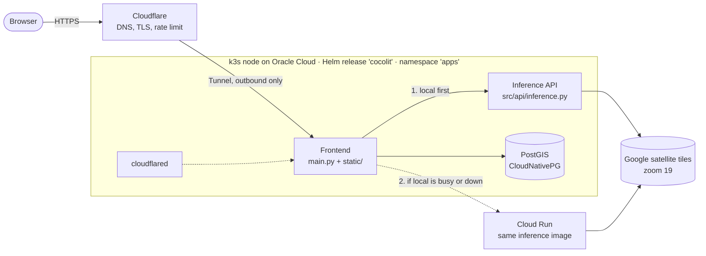
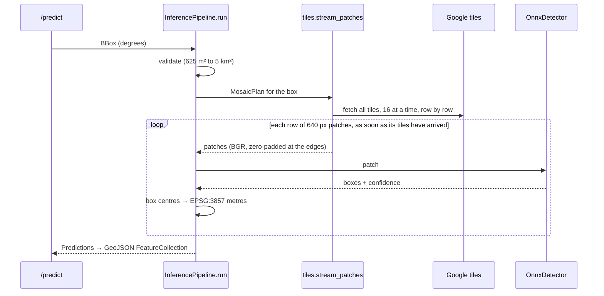
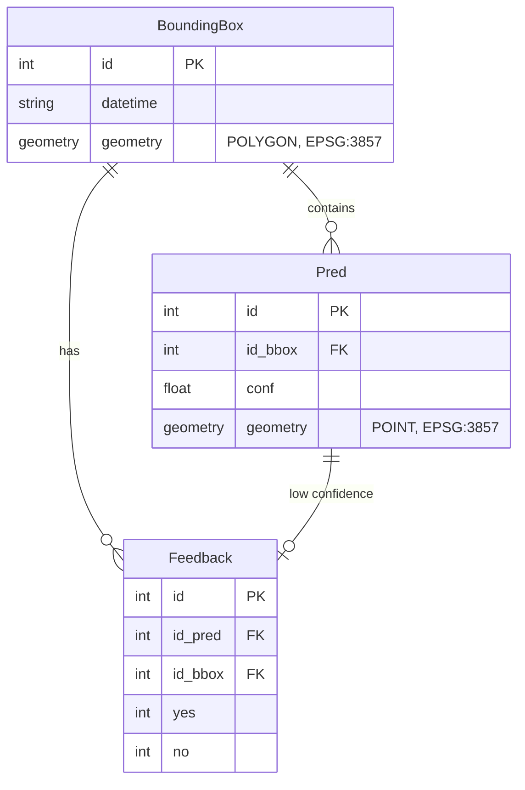

# Architecture

Cocolit counts coconut trees in satellite imagery. A user draws a box on a map,
a YOLO11n model detects the trees inside it, and the result is drawn on the map
and saved to a spatial database.

This page describes how the system is built and deployed, how a request flows
through it, and where to make changes.

## System overview



| Component | Code | Runs as | Job |
|---|---|---|---|
| Frontend | `main.py`, `static/`, `src/inference_router.py` | Deployment `cocolit-streamlit-deployment`, port 8501 | Serves the map UI; validates boxes; routes inference; saves results; statistics |
| Inference API | `src/api/inference.py`, `pipelines/inference.py`, `src/utils/` | Deployment `cocolit-inference-server`, port 8000 | Downloads imagery for a box, runs the model, returns tree points as GeoJSON |
| Database | `src/database/`, `src/dal/` | CloudNativePG `Cluster` `postgis-cluster` | Stores boxes, detected trees and low-confidence candidates for feedback |
| Tunnel | chart `cloudflared_deployment.yaml` | Deployment `cocolit-cloudflared` | Outbound connection to Cloudflare; the node needs no open inbound ports |
| Overflow | same inference image | Cloud Run service `cocolit-inference` | Takes requests when the local inference pod is busy or down; scales to zero |

The deployment names keep their historical `streamlit` prefix; the frontend is
no longer Streamlit.

## Frontend

`main.py` is a FastAPI app with three jobs:

- **Serve the UI.** `static/index.html`, `static/style.css` and
  `static/js/app.js` are mounted at `/`. The UI is vanilla JavaScript with
  Leaflet (maps), Turf.js (live area) and Leaflet.heat (heatmap). At build
  time, `frontend.Dockerfile` stamps a version into the JS/CSS URLs because
  Cloudflare caches those files for hours.
- **Run inference** (`POST /api/inference`): validate the drawn shape, ask
  the router for predictions, save them and return them in EPSG:4326.
- **Statistics** (`GET /api/statistics`): totals, a per-country table and
  heatmap points for every saved detection.

It also exposes `GET /healthz` for Kubernetes probes and creates any missing
database tables on startup.

### Drawing a box (`static/js/app.js`)

The box tool uses **pointer events**, so mouse, touch and pen share one
code path:

1. **Draw a box** turns on draw mode and disables map panning and zooming,
   so a drag draws instead of moving the map.
2. `pointerdown` records the start corner, and `pointermove` resizes the
   rectangle and updates a tooltip with the live area. The tooltip turns red
   above 0.5 km².
3. `pointerup` finishes the box; a tap (under 10 px of movement) is ignored.
   Boxes over 0.5 km² are rejected in the browser. Otherwise the GeoJSON is
   posted to `/api/inference`.
4. Each detected tree is drawn as a small circle. The status line above the
   map reports the result, or an error such as a rate limit (429) or an
   invalid box (422).

**Try another location** cycles through `SPOTS` in `app.js`: dense coconut
areas, each verified by running the model there, with village names from
OpenStreetMap reverse geocoding.

### Local-first routing (`src/inference_router.py`)

`InferenceRouter.predict()` decides where each request runs:

- If fewer than `INFERENCE_MAX_LOCAL` requests are in flight locally
  (default 1), the request goes to the **local** inference service.
- If local is already busy, it goes straight to the **overflow** URL
  (Cloud Run) instead of queueing.
- If local fails with a connection error, a timeout, or a 502/503/504, the
  request is retried once on overflow. Other errors (for example 422, box
  too big) are raised and not retried.
- Without an overflow URL, everything goes to local.

The response header `X-Inference-Backend: local|overflow` shows which one
served the request. Blocking work (HTTP and geopandas) runs in a thread via
`asyncio.to_thread`, so one slow request doesn't freeze the frontend.

## Inference API

`src/api/inference.py` exposes `POST /predict` (body:
`{xmin, ymin, xmax, ymax}` in degrees) and `GET /health`. If
`INFERENCE_API_KEY` is set (it is on Cloud Run), `/predict` requires a
matching `X-Api-Key` header. Boxes that are too large or too small return 422.

### Pipeline (`pipelines/inference.py`)



- **Tiles** (`src/utils/tiles.py`). `MosaicPlan.for_bounds()` works out which
  zoom-19 tiles cover the box and how they crop to the box exactly, using the
  same maths and rounding as the earlier rasvec GeoTIFF pipeline.
  `_download()` fetches and decodes tiles concurrently into one `uint8`
  canvas. `stream_patches()` yields each row of 640 × 640 patches as soon as
  the tiles under it have landed, so the model starts while later tiles are
  still downloading. A missing tile (404) stays black; other HTTP errors fail
  the request.
- **Model** (`src/utils/detector.py`). `OnnxDetector` runs `models/best.onnx`
  on onnxruntime and reproduces Ultralytics' pre- and post-processing:
  BGR→RGB, scale to 0–1, confidence above 0.25, NMS at IoU 0.7, boxes clipped
  to the patch. Its output matches Ultralytics exactly, without PyTorch in
  the image.
- **Output.** Box centres are mapped from patch pixels to EPSG:3857 metres
  and returned as a GeoJSON FeatureCollection with a `conf` property. An
  empty result is an empty FeatureCollection, not an error.
- **Telemetry.** Every stage (`validate`, `detect`, `postprocess`) is timed
  into `bbox.timings` and recorded as an OpenTelemetry span and histogram.
  `tile_wait` and `model` split the `detect` time between waiting for tiles
  and running the model. The calls are no-ops until `src/telemetry.py` is
  wired in.

The model card and its AGPL-3.0 licence are in `models/README.md`.

### Performance

`scripts/benchmark_inference.py`, Apple M1, identical detections before and
after:

| Area | Earlier (rasvec GeoTIFFs + Ultralytics) | Now | Peak RSS |
|---|---|---|---|
| 0.1 km² | 0.38 s | 0.21 s | 263 MB |
| 1 km² | 1.70 s | 1.40 s | 365 MB |
| 2.5 km² | 4.52 s | 3.08 s | 525 MB |
| 4.9 km² | 8.04 s | 5.9 s | 723 MB |

About 70% of the time is now the model itself. The next speed-ups are an
INT8 model (1.8× faster but only 90–96% agreement with FP32, so it needs
validating on labelled data), batched inference (which needs a
dynamic-batch export from the original `.pt` weights), and a cache for
repeated areas.

## Database

PostGIS on CloudNativePG; tables are SQLModel classes in
`src/database/model.py`, created on frontend startup.



- `preds_bbox_to_database()` saves a box with all its trees. Trees with
  confidence below 0.3 also get a `Feedback` row, collecting candidates for
  review and retraining. A box with no trees is not stored, because the box
  is saved through its predictions.
- `read_data()` loads every prediction and joins it with the country
  boundaries in `data/countries/` in Python. That's fine at the current size;
  for larger data, move the aggregation into PostGIS (for example
  `ST_Within` with a `GROUP BY`).

## Deployment

The live site runs on a single k3s node in **Oracle Cloud** (region
`ap-hyderabad-1`), reached only through the Cloudflare Tunnel.

| | Today | Long-term |
|---|---|---|
| Node | `cocolit-x86`: VM.Standard.E5.Flex, 1 OCPU (2 vCPUs), 6 GB, amd64 | `cocolit-a1`: VM.Standard.A1.Flex, arm64, Always Free |
| Paid by | Trial credits | Always Free |
| PostGIS data | The node's boot volume | A separate block volume |

The A1 node is created as soon as Oracle has capacity (see
[Oracle Cloud](#oracle-cloud-infraoci)). Moving to it means deploying the
chart there, copying the database with `pg_dump`, and moving the tunnel
connector, the same steps used to move the site off the laptop.

### Kubernetes (Helm chart `infra/charts/cocolit`)

| Template | Creates | Enabled by |
|---|---|---|
| `inference_deployment.yaml`, `inference_service.yaml` | Inference pod and ClusterIP service (probes on `/health`, 1 Gi memory limit, no CPU limit) | always |
| `streamlit_deployment.yaml`, `streamlit_service.yaml` | Frontend pod and service (probes on `/healthz`) | always |
| `postgis_manifest.yaml`, `postgres-secret.yaml` | CloudNativePG cluster and credentials | always (needs the CNPG operator) |
| `cloudflared_deployment.yaml` | Tunnel connector | `cloudflared.enabled` |
| `inference_hpa.yaml` | Autoscaler | `inference.hpa.enabled` (off for one node) |
| `streamlit_ingress.yaml`, `clusterissuer.yaml` | Traefik ingress and Let's Encrypt | `ingress.enabled`, `clusterIssuer.enabled` (off behind the tunnel) |

- **`values.yaml`** holds the defaults.
- **`values-oci.yaml`** is the live setup: CI-built multi-arch images from
  GHCR pinned by short SHA (bump `tag` to ship a new build), the tunnel on,
  ingress and cert-manager off, and a multi-arch PostGIS image.
- **`values-laptop.yaml`** is a local test setup: k3s on Colima with locally
  built images (`pullPolicy: Never`).
- **Credentials** come from a gitignored `secrets-oci.yaml` or
  `secrets-laptop.yaml`. The tunnel token and the overflow URL and key are
  Kubernetes secrets created outside the chart.

`NODE=x86 scripts/deploy_oci.sh` deploys to Oracle Cloud over SSH. The k3s API
port is not open, so Helm runs on the node itself, and the secrets file is
streamed on stdin instead of being copied to the node. The script also
installs Helm and the CloudNativePG operator on first run.

`scripts/deploy_laptop.sh` builds both images locally and runs `helm upgrade
--install` on Colima. Pass `--set cloudflared.enabled=false` there, or the
laptop joins the live tunnel and splits traffic between two databases.

### Edge: Cloudflare

- DNS for `prithvilabs.com`; the apex and `www` redirect to
  `cocolit.prithvilabs.com`.
- The published tunnel route maps `cocolit.prithvilabs.com` to
  `http://cocolit-streamlit-service.apps.svc.cluster.local:80`.
- A WAF rate-limiting rule on `/api/inference` allows 10 requests per 10 s
  per IP, then blocks for 10 s.

### Overflow: Cloud Run

`scripts/deploy_cloud_run.sh`:

- builds the inference image for amd64 with Cloud Build and pushes it to
  Artifact Registry, keeping the newest 2 images;
- deploys it with 1 vCPU, 1 GiB, concurrency 1, min-instances 0,
  max-instances 2 and an API key;
- writes the URL and key into the `inference-overflow` secret. Turn it on
  with `--set overflow.enabled=true`.

### Oracle Cloud (`infra/oci`)

OpenTofu sets up:

- a compartment and a VCN whose security list only allows SSH from one IP;
- one VM per enabled node (`a1_enabled`, `x86_enabled`), each with k3s
  installed by cloud-init;
- for the A1 node, a separate 100 GB data volume mounted at k3s's storage
  path, so the database survives replacing the node.

`retry-apply.sh` re-runs `tofu apply` until Oracle has A1 capacity; the
running x86 node is left untouched by each attempt. A1 shapes were out of
capacity in Hyderabad, and so was E4, which is why the bridge node is E5.

### Images

| Image | Dockerfile | Contents | Size (compressed) |
|---|---|---|---|
| Inference | `inference.Dockerfile` | onnxruntime, NumPy, Pillow, httpx, FastAPI, the model | ≈111 MB |
| Frontend | `frontend.Dockerfile` | FastAPI, geopandas, SQLModel/GeoAlchemy2, psycopg 3, static UI | ≈160 MB |

Both use only pure wheels (no compilers or GDAL), run as UID 10001, and
build for arm64 and amd64.

## Configuration

| Variable | Service | Purpose |
|---|---|---|
| `INFERENCE_URL` | frontend | Local inference endpoint (set by the chart) |
| `INFERENCE_OVERFLOW_URL` | frontend | Cloud Run `/predict` URL; unset = no overflow |
| `INFERENCE_API_KEY` | both | Shared secret; the frontend sends it, inference requires it if set |
| `INFERENCE_MAX_LOCAL` | frontend | Concurrent local requests before overflowing (default 1) |
| `POSTGRES_HOST`, `POSTGRES_DATABASE`, `POSTGRES_USERNAME`, `POSTGRES_PASSWORD` | frontend | Database connection (or `local_database` with a full URL); unset = no database |
| `SMTP_FROMADDR`, `SMTP_TOADDRS`, `SMTP_USERNAME`, `SMTP_PASSWORD` | frontend | Error emails |
| `ORT_THREADS` | inference | onnxruntime intra-op threads (default: all cores) |
| `PORT` | inference | Listen port (Cloud Run sets it; default 8000) |
| `OTEL_EXPORTER_OTLP_ENDPOINT` | both | Enables OpenTelemetry export once wired in (`otel.endpoint` in the chart) |

`configs/config.yml` sets the model path (`model.path`) and the number of
concurrent tile downloads (`inference.tile_workers`, default 16).

## Where to change things

| To change… | Edit |
|---|---|
| Page text, layout, sections | `static/index.html` |
| Colours, spacing, mobile layout | `static/style.css` (palette in the `:root` variables) |
| Drawing, size limit in the UI, marker colours, status messages, featured locations (`SPOTS`) | `static/js/app.js` |
| API routes, validation, saving | `main.py` |
| When requests overflow to Cloud Run | `src/inference_router.py`, `overflow.maxLocal` in the chart |
| Box size limits (server) | `BBox.valid_bbox()` in `src/data_struct/bbox.py` |
| Tile source, zoom, download concurrency | `src/utils/tiles.py`, `configs/config.yml` |
| Detection thresholds (confidence, NMS) | `OnnxDetector` in `src/utils/detector.py` |
| The model | replace `models/best.onnx` (same 1×3×640×640 input) and update `models/README.md` |
| Tables and stored fields | `src/database/model.py`, `src/dal/preds.py` |
| Resources, probes, optional components | `infra/charts/cocolit/values*.yaml` and templates |

## Testing

```bash
pytest tests --ignore=tests/integration      # unit tests, no network
pytest tests/integration                      # real tiles + model (network)
python -m scripts.benchmark_inference --sizes 0.1 0.5 1 2.5
```

The unit tests cover:

- tile placement, cropping and georeferencing against the rasvec formulas;
- streaming patches matching the download-then-slice result;
- conversion from pixels to map coordinates;
- empty results;
- GeoJSON parity with geopandas;
- routing and overflow decisions;
- API key checks and 422 responses.
