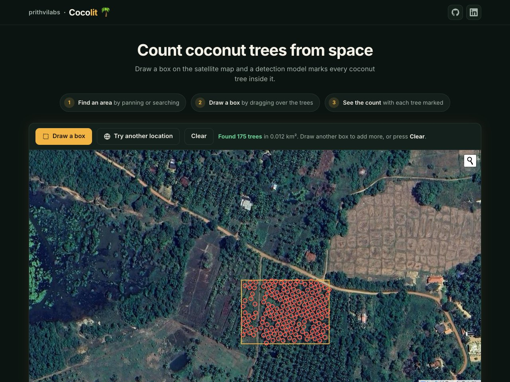

# Cocolit

**Count coconut trees from satellite imagery.** Draw a box on the map, and a
[YOLO11n](https://docs.ultralytics.com/models/yolo11/) detection model
(Ultralytics, AGPL-3.0) marks every coconut tree inside it.

**Live:** [cocolit.prithvilabs.com](https://cocolit.prithvilabs.com) ·
**Source:** [github.com/davnish/cocolit](https://github.com/davnish/cocolit)



## What it does

- **Draw to detect:** press **Draw a box** and drag (mouse or finger) over up
  to 0.5 km². A live tooltip shows the area while you draw.
- **Try another location:** jump between dense coconut areas in Sri Lanka,
  India and Mexico.
- **Every tree marked:** each detected coconut tree is drawn on the map, with
  the count, area and trees per km² for your session.
- **Coordinates bar:** shows the pointer or map-centre position. Click the map
  to pin a point and copy it.
- **Statistics:** every scan is saved in PostGIS and summarised as a heatmap
  and a per-country table.

## How it is built

A FastAPI frontend serves the map and calls a separate inference API, which
streams satellite tiles into memory and runs the model with onnxruntime while
the tiles are still downloading. Both run on a single k3s node behind a
Cloudflare Tunnel, with Cloud Run taking requests when the node is busy.

| Area | Inference time | Peak memory |
|---|---|---|
| 0.1 km² | 0.21 s | 263 MB |
| 1 km² | 1.40 s | 365 MB |
| 2.5 km² | 3.08 s | 525 MB |

Measured on an Apple M1, CPU only.

See **[Architecture](architecture.md)** for the full design: components,
request flow, inference pipeline, database, deployment, configuration and
where to change things.

## Run it locally

```bash
pip install -r requirements_inference.txt -r requirements_streamlit.txt
uvicorn src.api.inference:app --port 8000
INFERENCE_URL=http://127.0.0.1:8000/predict uvicorn main:app --port 8501
```

Then open <http://localhost:8501>.

## License

The code is MIT licensed. The model weights (`models/best.onnx`) are YOLO11n
by Ultralytics and are AGPL-3.0. Satellite imagery is © Google.
